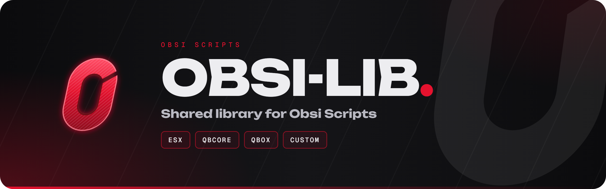
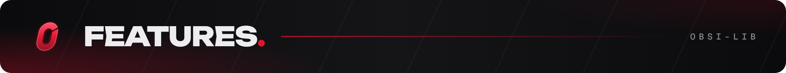
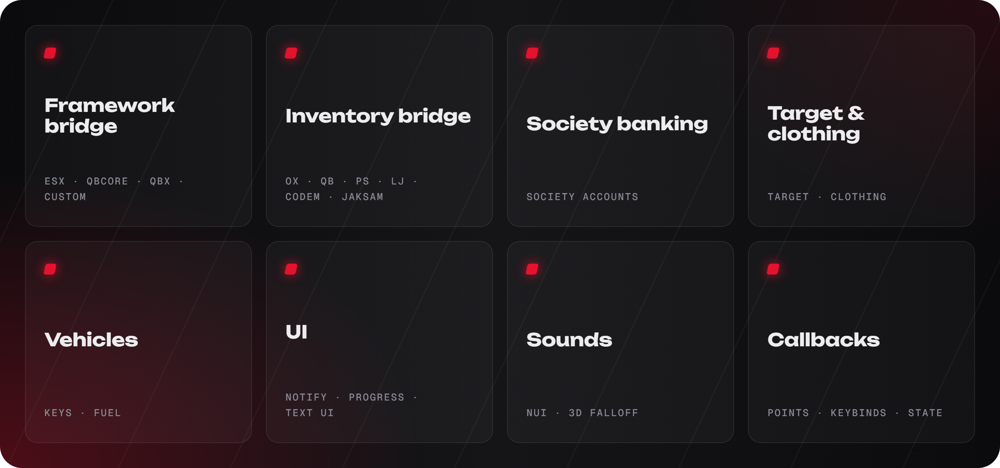
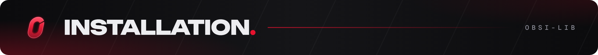
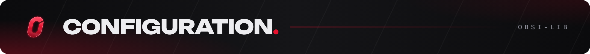
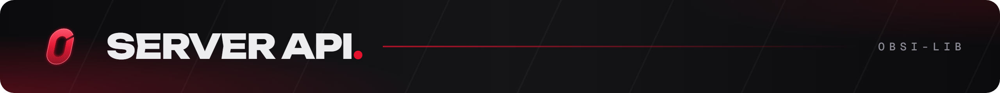
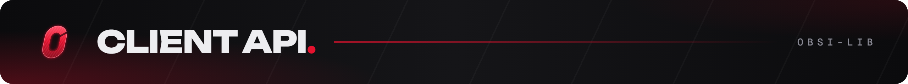
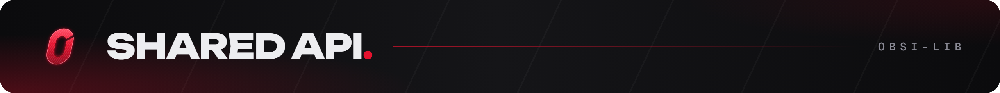
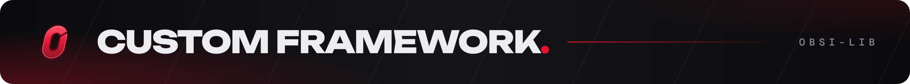
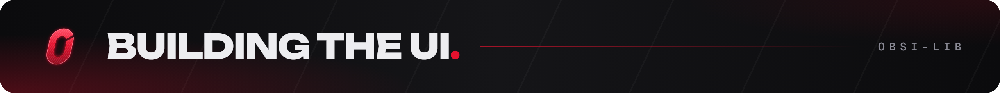

<p align="center">
  
</p>

<p align="center">
  <a href="https://github.com/Obsi-Scripts/obsi-lib/releases"></a>
  <a href="./LICENSE"></a>
  
  
</p>

<h3 align="center">One API for every server.</h3>

<p align="center">
  Framework, inventory, banking, target, clothing, vehicle keys and fuel behind one consistent API,<br>
  plus notifications, progress bar, text UI and 3D sounds. Detected automatically, overridable from one folder.
</p>

<p align="center">
  <a href="#installation"><b>Install</b></a> &nbsp;·&nbsp;
  <a href="#configuration"><b>Config</b></a> &nbsp;·&nbsp;
  <a href="#api-reference-server"><b>Server API</b></a> &nbsp;·&nbsp;
  <a href="#api-reference-client"><b>Client API</b></a> &nbsp;·&nbsp;
  <a href="#custom-framework-or-inventory"><b>Custom framework</b></a> &nbsp;·&nbsp;
  <a href="https://github.com/Obsi-Scripts/obsi-lib/releases"><b>Download</b></a>
</p>

<br>

<table>
<tr>
<td width="50%" valign="top">

**Server**

```lua
if ObsiLib.job.is(source, 'police')
   and ObsiLib.items.has(source, 'handcuffs') then
    ObsiLib.money.add(source, 500, 'bank', 'arrest bonus')
    ObsiLib.notify(source, {
        title = 'Bonus',
        description = 'You received **$500**.',
        type = 'success',
    })
end
```

</td>
<td width="50%" valign="top">

**Client**

```lua
local done = ObsiLib.ui.progress({
    label = 'Picking the lock',
    duration = 5000,
    anim = { dict = 'mp_arresting', clip = 'a_uncuff' },
    cancelable = true,
})
if done then
    ObsiLib.sound.playAt(GetEntityCoords(PlayerPedId()), 'unlock', { range = 8.0 })
    ObsiLib.ui.showText({ key = 'E', label = 'Open door' })
end
```

</td>
</tr>
</table>

<table>
<tr>
<td width="33%" valign="top">

#### ⚡ Zero setup
Framework, inventory, banking, target, clothing, keys and fuel are detected on start. Force or disable any of them in `config.lua`.

</td>
<td width="33%" valign="top">

#### 🛡️ Safe by default
Item and money writes check balances first. Stash moves are validated and rolled back on the server. Callbacks only accept the player that was asked.

</td>
<td width="33%" valign="top">

#### 🧹 Cleans up after you
Callbacks, usable items, points, target zones, keybinds, DUIs and state listeners are removed when your resource stops.

</td>
</tr>
<tr>
<td valign="top">

#### 🧩 Patch, don't fork
Replace one framework or inventory function from `editable/` without touching the library.

</td>
<td valign="top">

#### 🎛️ UI included
Notifications, progress bar and text UI in the Obsi look, with an accent colour you set.

</td>
<td valign="top">

#### 🔊 3D sounds
NUI sound engine with live distance falloff, or xsound when it is running.

</td>
</tr>
</table>

<br>

<a id="features"></a>




| Area | Supported |
| --- | --- |
| Frameworks | ESX Legacy, QBCore, QBX, custom (`editable/`) |
| Inventories | ox_inventory, qb-inventory (v2 and v1), ps-inventory, lj-inventory, codem-inventory, jaksam_inventory, custom, framework items |
| Banking (society) | Renewed-Banking, okokBanking, qb-banking, qb-management, esx_society |
| Target | ox_target, qb-target |
| Clothing | illenium-appearance, fivem-appearance, qb-clothing, esx_skin / skinchanger |
| Vehicle keys | qbx_vehiclekeys, qb-vehiclekeys, wasabi_carlock, mk_vehiclekeys |
| Fuel | ox_fuel, LegacyFuel, cdn-fuel, ps-fuel, lc_fuel, native |
| Notifications | built-in, ESX, QBCore, ox_lib, custom |
| Sounds | built-in NUI player (live distance falloff), xsound |

Everything is detected automatically and every integration can be forced or turned off in the config.

<br>

<a id="installation"></a>


1. Download the latest release from [Releases](https://github.com/Obsi-Scripts/obsi-lib/releases).
   Release zips contain the built UI. If you cloned the repository, build the UI first
   (see [Building the UI](#building-the-ui)).
2. Put the folder in your resources as **`obsi-lib`** (the name matters, other scripts look it up by it).
3. Start it after your framework, inventory and `oxmysql`, and before any script that uses it:

   ```cfg
   ensure oxmysql
   ensure es_extended      # or qb-core / qbx_core
   ensure ox_inventory     # or your inventory
   ensure obsi-lib
   ensure obsi-whatever    # scripts that use obsi-lib
   ```

Requirements: FiveM server artifact with Lua 5.4 support, [oxmysql](https://github.com/overextended/oxmysql).

<br>

<a id="configuration"></a>


Server owners only touch the `editable/` folder:

| File | Purpose |
| --- | --- |
| `editable/shared/config.lua` | All settings (`ObsiConfig`). Shared with clients: no secrets here. |
| `editable/server/webhooks.lua` | Discord webhook urls (server only). |
| `editable/server/framework.lua`, `editable/client/framework.lua` | Custom framework functions and per-function patches. |
| `editable/server/inventory.lua`, `editable/client/inventory.lua` | Custom inventory functions and per-function patches. |
| `editable/server/notify.lua`, `editable/client/notify.lua` | Custom notification backend. |

The most used settings:

```lua
ObsiConfig.Locale = 'en'            -- 'en' | 'pl'
ObsiConfig.Framework = 'auto'       -- 'auto' | 'esx' | 'qb' | 'qbx' | 'custom'
ObsiConfig.Inventory = 'auto'       -- 'auto' | 'ox_inventory' | 'qb-inventory' | 'codem-inventory' | 'jaksam_inventory' | 'custom'
ObsiConfig.Notify = 'obsi'          -- 'obsi' (built-in) | 'esx' | 'qb' | 'ox' | 'custom'

ObsiConfig.Integrations = {
    Banking = 'auto', VehicleKeys = 'auto', Target = 'auto',
    Clothing = 'auto', Fuel = 'auto', Sound = 'auto',
}

ObsiConfig.UI = {
    Accent = '#e5122e',                              -- any hex colour
    Notify = { Position = 'top-right', Duration = 5000, MaxVisible = 5 },
    Progress = { Offset = 14, CancelKey = 73, CancelLabel = 'X' },
    TextUI = { Position = 'left' },
}
```

See the comments in `config.lua` for the rest (admin checks, police jobs, plates, stash fallback,
database tables, item images, developer tools).

## Using obsi-lib in your resource

Add the import to your `fxmanifest.lua`:

```lua
shared_script '@obsi-lib/init.lua'
```

and use the global `ObsiLib` anywhere. Without the import:

```lua
local ObsiLib = exports['obsi-lib']:get()
```

Server and client get different modules under the same names where it makes sense (`ObsiLib.items` reads
your own items on the client and edits anyone's items on the server).

Notes:

- Functions that wait for the server (`callback.await`, `money.get`, `license.has`, `ui.progress`, ...)
  must run inside a thread or an event handler.
- Things you register (callbacks, usable items, points, target zones, keybinds, DUIs, state listeners)
  are removed automatically when your resource stops.
- `ObsiLib.framework` and `ObsiLib.inventory` tell you what was detected.

<br>

<a id="api-reference-server"></a>


### Callbacks

```lua
-- Handler returns its answer (multiple values are fine) and may yield.
ObsiLib.callback.register('my_script:getPrice', function(source, itemName)
    return Prices[itemName] or 0
end)

ObsiLib.callback.unregister('my_script:getPrice')
ObsiLib.callback.call('my_script:getPrice', source, 'water')   -- run a handler directly

-- Ask a client handler (registered on the client) and wait for the answer.
local heading = ObsiLib.callback.awaitClient(source, 'my_script:heading', nil, 5000)
```

Each player can have at most 32 requests in flight; answers to `awaitClient` are only accepted from the
player that was asked.

### Players

```lua
ObsiLib.player.get(source)                -- xPlayer / QBCore Player / custom object
ObsiLib.player.list()                     -- { 1, 4, 7 }
ObsiLib.player.identifier(source)         -- ESX identifier / citizenid
ObsiLib.player.name(source)               -- 'John Smith'
ObsiLib.player.group(source)              -- 'admin'
ObsiLib.player.gender(source)             -- 'male' | 'female'
ObsiLib.player.fromIdentifier('ABC123')   -- source or nil
ObsiLib.player.isAdmin(source)            -- ACE, identifiers, groups from ObsiConfig.Admin
ObsiLib.player.isAdmin(source, { ace = 'myscript.admin', groups = { 'god' }, identifiers = { 'discord:123' } })
```

### Jobs

```lua
local job = ObsiLib.job.get(source)       -- { name, label, grade, gradeLabel, onDuty }
ObsiLib.job.is(source, 'police')          -- also accepts { 'police', 'sheriff' } or { police = true }
ObsiLib.job.set(source, 'mechanic', 2)
ObsiLib.job.setOffline('ABC123', 'unemployed', 0)   -- goes through job.set when the character is online
ObsiLib.job.setDuty(source, true)
ObsiLib.job.all()                         -- { police = { label, type, grades = { [0] = { label, payment, isboss } } } }
ObsiLib.job.copsOnline()                  -- jobs from ObsiConfig.PoliceJobs (optionally on duty only)
```

### Money

Accounts: `'cash'` (default), `'bank'`, `'black'` or any account name your framework knows.

```lua
ObsiLib.money.get(source, 'bank')
ObsiLib.money.add(source, 250, 'cash', 'job payout')
ObsiLib.money.remove(source, 100, 'bank', 'fine')   -- false when the balance is too low
ObsiLib.money.has(source, 1000, 'cash')
```

### Licenses

```lua
ObsiLib.license.has(source, 'weapon')   -- esx_license on ESX, metadata.licences on QBCore / QBX
```

### Items

```lua
ObsiLib.items.add(source, 'water', 2)
ObsiLib.items.add(source, 'id_card', 1, { owner = 'John Smith' })
ObsiLib.items.remove(source, 'lockpick', 1)          -- checks the count first, false when short
ObsiLib.items.count(source, 'water')                 -- 3
ObsiLib.items.has(source, 'water', 2)                -- true
ObsiLib.items.canCarry(source, 'gold_bar', 10)
ObsiLib.items.list(source)                           -- { { name, count, metadata, slot } }
ObsiLib.items.counts(source)                         -- { water = 3, bread = 1 }
ObsiLib.items.find(source, 'phone')                  -- { { slot, count, metadata } }
ObsiLib.items.catalog()                              -- { water = { label, weight, image, description } }
ObsiLib.items.label('water')                         -- 'Water'
ObsiLib.items.image('water')                         -- 'nui://ox_inventory/web/images/water.png'
```

Usable items:

```lua
ObsiLib.items.useable('repairkit', function(source, itemName, metadata, slot)
    if ObsiLib.items.remove(source, itemName, 1, nil, slot) then
        TriggerClientEvent('my_script:repair', source)
    end
end)
```

With ox_inventory the item must call the export (or be usable with `consume = 0`):

```lua
['repairkit'] = { label = 'Repair kit', weight = 500, server = { export = 'obsi-lib.useItem' } },
```

### Stashes

```lua
ObsiLib.stash.register('police_evidence', {
    label = 'Evidence', slots = 80, weight = 200000,
    groups = { police = 0 },          -- job = minimum grade
    clientOpen = true,                -- clients may open it with ObsiLib.stash.open on the client
    coords = vec3(441.8, -996.2, 30.7), radius = 2.0,  -- optional distance check for client requests
})

ObsiLib.stash.open(source, 'police_evidence')
ObsiLib.stash.add('police_evidence', 'weapon_pistol', 1, { serial = 'A1B2C3' })
ObsiLib.stash.remove('police_evidence', 'weapon_pistol', 1)
ObsiLib.stash.items('police_evidence')         -- { { name, count, metadata } }
ObsiLib.stash.count('police_evidence', 'weapon_pistol')
```

ox_inventory and qb-inventory use their own stashes. Other inventories get a stash stored in resource KVP
with a small keyboard menu; every move is checked on the server (session, counts, carry weight) and rolled
back when the second half fails.

### Society accounts

```lua
ObsiLib.society.provider()                 -- 'Renewed-Banking' | ... | 'none'
ObsiLib.society.balance('mechanic')
ObsiLib.society.deposit('mechanic', 500)
ObsiLib.society.withdraw('mechanic', 200)  -- false when the balance is too low
ObsiLib.society.sync('mechanic', 12000)    -- force a balance (creates the account if the bank supports it)
```

### Vehicles

```lua
local plate = ObsiLib.vehicle.generatePlate()          -- unique against the owned vehicles table
ObsiLib.vehicle.plateTaken('OBSI1234')
ObsiLib.vehicle.saveOwned({ src = source, model = 'sultan', plate = plate, props = props, price = 25000 })
ObsiLib.vehicle.giveKeys(source, plate, NetworkGetNetworkIdFromEntity(vehicle))
ObsiLib.vehicle.keysProvider()
```

### Notifications

```lua
ObsiLib.notify(source, {
    title = 'Garage', description = 'Vehicle **stored**.', type = 'success', -- success | error | warning | info
    duration = 5000, tag = 'Pillbox', position = 'top-right',
})
ObsiLib.notify(-1, 'Server restart in 5 minutes')   -- string shorthand, -1 = everyone
```

Descriptions support `**bold**`, `` `mono` `` and line breaks. HTML is shown as plain text.

### Sounds

```lua
ObsiLib.sound.play(source, 'door_bell', { volume = 0.6 })
ObsiLib.sound.play(-1, 'nui://my_script/sounds/siren.ogg', { id = 'siren', loop = true })
ObsiLib.sound.playAt(vec3(200.0, -800.0, 31.0), 'alarm', { range = 40.0, id = 'bank_alarm', loop = true })
ObsiLib.sound.stop(-1, 'bank_alarm')
```

Short names play `web/build/sounds/<name>.mp3` (put files in `web/public/sounds` before building).

### Client state

```lua
ObsiLib.state.push(source, 'gangZone', 'grove')   -- client reads ObsiLib.state.get('gangZone')
```

### Discord logs

```lua
-- 'main' is a key in editable/server/webhooks.lua; a raw https url works too.
ObsiLib.log('main', {
    title = 'Item sold', message = 'A player sold an item.', color = 0xE5122E,
    fields = { { name = 'Item', value = 'gold_bar', inline = true }, { name = 'Price', value = '$800', inline = true } },
})
ObsiLib.webhook.send('main', { content = 'Raw payload' })
```

Messages are queued and spaced so bursts do not hit Discord's rate limit.

### Version check

obsi-lib checks its own releases on start (`ObsiConfig.VersionCheck`). Other resources can reuse it:

```lua
ObsiLib.checkVersion(GetCurrentResourceName(), 'Obsi-Scripts/obsi-whatever')
```

<br>

<a id="api-reference-client"></a>


### Callbacks

```lua
CreateThread(function()
    local price = ObsiLib.callback.await('my_script:getPrice', 'water')       -- blocking
end)

ObsiLib.callback.trigger('my_script:getPrice', 'water', function(price) end) -- non blocking

-- Answer server side ObsiLib.callback.awaitClient(source, 'my_script:heading')
ObsiLib.callback.register('my_script:heading', function(payload)
    return GetEntityHeading(PlayerPedId())
end)
```

### Player, job, money, licenses

```lua
ObsiLib.player.data()        -- framework player data
ObsiLib.player.gender()      -- 'male' | 'female'
ObsiLib.player.isDead()

ObsiLib.job.get()            -- { name, label, grade, gradeLabel, onDuty }
ObsiLib.job.is({ 'police', 'sheriff' })
ObsiLib.job.copsOnline()     -- asks the server

local cash, bank = ObsiLib.money.get()                 -- blocking
ObsiLib.money.get(function(cash, bank) end)            -- async
local hasLicense = ObsiLib.license.has('driver')       -- blocking, or pass a cb
```

### Items (read only)

```lua
ObsiLib.items.count('water')
ObsiLib.items.has('lockpick')
ObsiLib.items.list()      -- { { name, count, metadata, slot } }
ObsiLib.items.counts()    -- { water = 3 }
```

### Stashes

```lua
ObsiLib.stash.open('police_evidence')   -- only stashes registered with clientOpen = true
```

### Notifications and UI

```lua
ObsiLib.notify({ title = 'Shop', description = 'Not enough money.', type = 'error' })

-- Progress bar (blocking, true when finished)
if ObsiLib.ui.progress({
    label = 'Repairing', description = 'Engine bay', duration = 7500, cancelable = true,
    anim = { dict = 'mini@repair', clip = 'fixing_a_player' },
    prop = { model = 'prop_tool_wrench', bone = 57005, pos = vec3(0.1, 0.0, 0.0), rot = vec3(0.0, 0.0, 0.0) },
    disable = { move = true, car = true, combat = true },
}) then
    TriggerServerEvent('my_script:repaired')
end
ObsiLib.ui.cancelProgress()
ObsiLib.ui.progressActive()

-- Text UI
ObsiLib.ui.showText({ key = 'E', label = 'Open', description = 'Storage locker' })
ObsiLib.ui.hideText()
ObsiLib.ui.textOpen()

-- Big centred message
ObsiLib.ui.banner({ title = 'WASTED', description = 'You were knocked out', duration = 4000 })

-- Accent colour at runtime
ObsiLib.ui.setAccent('#5fb878')
```

`anim` can also be `{ scenario = 'WORLD_HUMAN_WELDING' }`; `prop` can be a list. `disable` groups:
`move`, `sprint`, `car`, `combat`, `mouse`; `keys = { 'E', 'F' }` blocks single keys.

### Sounds

```lua
ObsiLib.sound.play('click', { volume = 0.4 })
local id = ObsiLib.sound.playAt(GetEntityCoords(PlayerPedId()), 'engine_loop', { range = 15.0, loop = true })
ObsiLib.sound.setPosition(id, newCoords)   -- volume follows the distance every 100 ms
ObsiLib.sound.stop(id)
ObsiLib.sound.stopAll()

ObsiLib.sound.broadcast('horn', { range = 30.0, id = 'horn' })  -- everyone near you; server checks range and rate
ObsiLib.sound.unbroadcast('horn')

-- Url sounds: xsound when it runs, the built-in player otherwise
ObsiLib.sound.url('radio_1', 'https://example.com/stream.mp3', { coords = coords, range = 25.0, volume = 0.3 })
ObsiLib.sound.seek('radio_1', 30)   -- xsound only
ObsiLib.sound.provider()            -- 'xsound' | 'nui' | 'none'
```

Clients can only broadcast short sound names unless `ObsiConfig.Sound.AllowRemoteUrls = true`.

### Reactive state

```lua
ObsiLib.state.get('vehicle')      -- built-in: ped, vehicle, seat, weapon, playerId, serverId
ObsiLib.state.set('menuOpen', true)

local id = ObsiLib.state.on('vehicle', function(vehicle, previous)
    if vehicle then print('entered', vehicle) end
end)
ObsiLib.state.off(id)

-- Plain event alternative
AddEventHandler('obsi-lib:state:weapon', function(weapon, previous) end)
```

### Points

```lua
local point = ObsiLib.point.add({
    coords = vec3(441.8, -996.2, 30.7),
    distance = 2.0,
    onEnter = function() ObsiLib.ui.showText({ key = 'E', label = 'Evidence' }) end,
    onExit = function() ObsiLib.ui.hideText() end,
    inside = function()            -- every frame while in range
        if IsControlJustPressed(0, 38) then ObsiLib.stash.open('police_evidence') end
    end,
})

point.remove()
ObsiLib.point.closest()  ObsiLib.point.nearby()  ObsiLib.point.all()
```

### Keybinds

```lua
local bind = ObsiLib.keybind.add({
    name = 'my_script_tablet', description = 'Open tablet', key = 'F5',
    onPress = function() OpenTablet() end,
    onRelease = function() end,
})
bind.disable(true)
bind.currentKey()   -- the key the player bound in the settings
```

### Target

```lua
ObsiLib.target.addBox('mechanic_desk', vec3(-347.4, -133.2, 39.0), vec3(1.5, 1.0, 2.0), 70.0, {
    { name = 'duty', label = 'Toggle duty', icon = 'clock', onSelect = function() TriggerServerEvent('mechanic:duty') end },
})
ObsiLib.target.addSphere('atm_1', coords, 1.0, options)
ObsiLib.target.addEntity(vehicle, { { name = 'trunk', label = 'Open trunk', icon = 'car', canInteract = function(entity) return true end, onSelect = function(entity) end } })
ObsiLib.target.removeEntity(vehicle, 'trunk')
ObsiLib.target.remove('mechanic_desk')
ObsiLib.target.provider()   -- 'ox_target' | 'qb-target' | 'none'
```

Icons take a FontAwesome class (`'fas fa-box'`) or a short name (`'box'`, `'car'`, `'key'`, ...).

### Clothing

```lua
local outfit = ObsiLib.clothing.get()   -- { components = {...}, props = {...} }
ObsiLib.clothing.apply({
    components = { { component_id = 11, drawable = 55, texture = 0 } },
    props = { { prop_id = 0, drawable = 46, texture = 0 } },
})
ObsiLib.clothing.restore()              -- back to the saved clothes
```

`apply` also takes qb-clothing `outfitData` tables and esx_skin `tshirt_1` style tables.

### DUI

```lua
local screen = ObsiLib.dui.create({ url = 'https://example.com', width = 1280, height = 720 })
screen.replace('prop_tv_flat_01', 'script_rt_tvscreen')
screen.send({ action = 'play' })
screen.setUrl('https://example.org')
screen.destroy()
```

### Game helpers

```lua
ObsiLib.game.requestModel('prop_tool_box_04')
ObsiLib.game.requestAnimDict('mini@repair')
local vehicle, distance = ObsiLib.game.closestVehicle(nil, 5.0)
local playerId, ped, dist = ObsiLib.game.closestPlayer(nil, 3.0)
local props = ObsiLib.game.vehicleProps(vehicle)
ObsiLib.game.setVehicleProps(vehicle, props)
ObsiLib.game.getFuel(vehicle)   ObsiLib.game.setFuel(vehicle, 100)
ObsiLib.game.vehicleType(vehicle)   -- 'car' | 'motorcycle' | 'boat' | ...
ObsiLib.game.vehicleLocked(vehicle)  ObsiLib.game.vehicleLightsOn(vehicle)  ObsiLib.game.vehicleEngineOn(vehicle)
ObsiLib.game.weaponInfo()            -- { hash, clip, total }
local hit, coords, entity = ObsiLib.game.raycast(25.0)

ObsiLib.vehicle.giveKeys(vehicle)    -- client side key resources
```

`/obsicoords` (configurable) toggles a pointer that prints the coordinates you click.

<br>

<a id="api-reference-shared"></a>


```lua
ObsiLib.framework            -- 'esx' | 'qb' | 'qbx' | 'custom'
ObsiLib.inventory            -- 'ox_inventory' | 'qb-inventory' | ... | 'custom' | 'framework'
ObsiLib.version              -- '1.0.0'
ObsiLib.detect()             -- run detection again

ObsiLib.util.round(3.14159, 2)         -- 3.14
ObsiLib.util.percent(25, 200)          -- 12.5
ObsiLib.util.clamp(150, 0, 100)        -- 100
ObsiLib.util.trim('  text ')
ObsiLib.util.split('a,b,c', ',')
ObsiLib.util.randomString(8, 'ABC123')
ObsiLib.util.formatNumber(1250000)     -- '1 250 000'
ObsiLib.util.identifierValue('discord:123')   -- '123'
ObsiLib.util.discordId(source)         -- server only
ObsiLib.util.identifiers(source)       -- server only, { license = 'license:..', discord = 'discord:..' }

ObsiLib.locale('stash_title')          -- obsi-lib's own strings

ObsiLib.debug.print('warn', 'Something happened', { any = 'table' })
ObsiLib.debug.log('only printed with ObsiConfig.Debug')
ObsiLib.debug.dump(value)              -- pretty JSON string
```

### Exports

For scripts that do not use the object:

| Side | Export |
| --- | --- |
| both | `get` |
| server | `notify`, `playSound`, `playSoundAt`, `stopSound`, `copsOnline`, `generatePlate`, `log`, `useItem` (ox_inventory item hook) |
| client | `notify`, `progress`, `cancelProgress`, `progressActive`, `showText`, `hideText`, `textOpen`, `playSound`, `playSoundAt`, `stopSound` |

<br>

<a id="custom-framework-or-inventory"></a>


Set `ObsiConfig.Framework = 'custom'` and fill in `ObsiEditable.framework` in
`editable/server/framework.lua` and `editable/client/framework.lua`. Every function is optional; missing
ones fall back to a safe default.

To change a single behaviour on a supported framework, put a function with the same name in
`ObsiEditable.frameworkPatch`:

```lua
ObsiEditable.frameworkPatch = {
    gender = function(src)
        return MyIdentity.getGender(src)
    end,
}
```

Inventories work the same way with `ObsiConfig.Inventory = 'custom'`, `ObsiEditable.inventory` and
`ObsiEditable.inventoryPatch`. Returning `nil` from a custom inventory function falls back to the
framework's own item functions. Stash hooks (`registerStash`, `openStash`, `stashAdd`, `stashRemove`,
`stashItems`) are optional.

<br>

<a id="building-the-ui"></a>


The UI lives in `web/` (React 19, TypeScript, Vite, Zustand, Tailwind CSS v4).

```bash
cd web
pnpm install
pnpm build      # outputs web/build, loaded by fxmanifest
pnpm dev        # browser dev mode with mock data and a control panel
```

`web/build` is not committed; release zips include it.

## License

obsi-lib is free software under the [GNU General Public License v3.0](LICENSE).

<br>

<p align="center">
  
</p>
